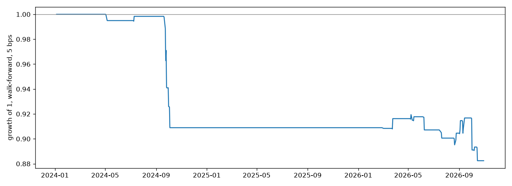
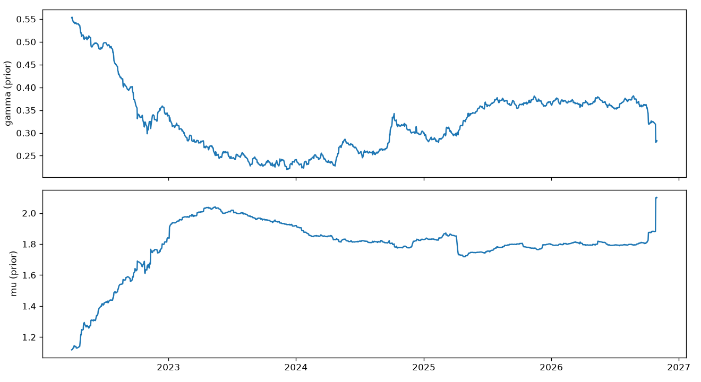
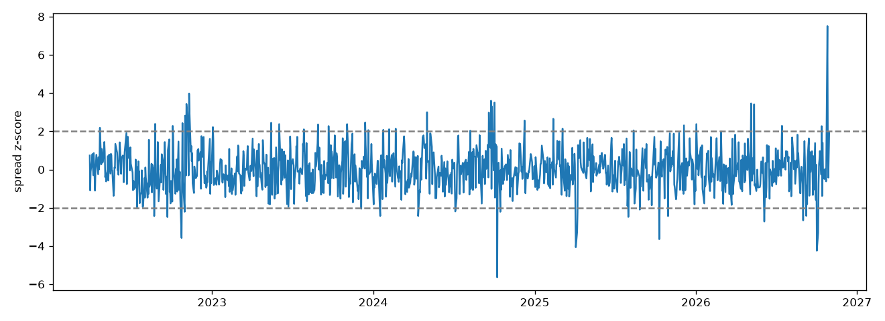

# Kalman-Filter Pairs Trading (EWH/EWZ)

A dynamic hedge-ratio pairs strategy on two country ETFs, tested honestly: no look-ahead, trading costs, next-day fills and walk-forward parameter selection on pinned data.

**Result: this pair shows no tradable edge out of sample.** The walk-forward Sharpe at 5 bps per side is -1.17, and its 95% block-bootstrap interval runs from -2.10 to 0.44. The value of this repo is the filter, the test harness and the reasons the earlier, better-looking backtest did not hold up.

## Run it

```bash
pip install -r requirements.txt
python src/run_all.py        # rebuilds results/ from data/prices.csv, same numbers every run
python src/fetch_data.py     # optional: re-download prices (this changes the pinned data)
```

The notebooks in `scripts/` show the cointegration checks and the filter's outputs, and read the same pinned file.

## Results

Daily data from 2022-01-03 to 2026-10-30. Each quarter, parameters are chosen by Sharpe on the prior 504 trading days and traded for the next 63 days, which gives 708 out-of-sample days. Exposure is 1x gross, with 0.5% a year charged on the short leg.

| Walk-forward test | CAGR | Sharpe | Max drawdown | Round trips | Win rate |
|---|---|---|---|---|---|
| 0 bps per side | -3.3% | -0.80 | -9.4% | 26 | 50% |
| **5 bps per side** | **-4.4%** | **-1.17** | **-11.8%** | **17** | **41%** |
| 10 bps per side | -4.4% | -1.42 | -11.9% | 9 | 22% |

The strategy is in the market only 2-6% of days, so these results rest on few trades. Treat them as "no evidence of an edge", not a precise estimate. Full output is in `results/metrics.json`.



### Why win rate misleads here

One fixed parameter set (`q=1e-4`, 60-day window, entry 2.0, exit 0.5), run over the full sample at 5 bps, wins 64% of its 47 round trips and still has a Sharpe of 0.07. Average wins are smaller than average losses (+0.8% against -1.3%), so a high win rate does not pay.

## What changed from the original version

| Problem in the original | Fix |
|---|---|
| The spread used the filter state *after* updating on today's price | The spread is now the one-step-ahead innovation, built from the state known at t-1 |
| `bfill()` on the rolling noise estimate put future data in the first 50 days | The estimate uses data through t-1, with a fixed floor during warm-up |
| No end date, so results changed daily (the OLS beta moved from -0.41 to +0.53) | Prices are pinned in `data/prices.csv` |
| Same-bar fills and no costs | Signal at close t, fill at close t+1, with costs and short borrow |
| One in-sample window | Walk-forward parameter selection |

Removing the look-ahead was not what hurt performance. On the same fixed parameters, the old spread gets a Sharpe of -0.23 and the new one 0.07. Out-of-sample selection is what takes the result negative.

### The earlier QuantConnect backtest

`results/QC_Results.png` and `results/QC_Graph.png` are kept for the record. That run showed a 60% win rate, 7.4% CAGR, Sharpe 0.14, PSR 19%, and an 11.5% drawdown from 226 orders. It charged **$0 in fees** and was in-sample. Its algorithm code is not in this repo, so it cannot be reproduced from here.

## Is the pair cointegrated?

No. A time-varying hedge ratio does not change that: a filter that re-fits every day will make almost any residual look stationary, so a stationary-looking spread here is not evidence of a relationship.

| Test | First 504 days | Full sample |
|---|---|---|
| Engle-Granger p-value | 0.19 | 0.28 |
| ADF on log EWH, p-value | 0.53 | 0.72 |
| ADF on log EWZ, p-value | 0.12 | 0.44 |

## The model

Log prices follow $y_{1t} = \mu_t + \gamma_t y_{2t} + \varepsilon_t$, with the state $x_t = [\mu_t, \gamma_t]^\top$ as a random walk.

**Predict:**

$$x_t^- = x_{t-1}, \quad P_t^- = P_{t-1} + Q$$

**Spread (the innovation), using only what was known at t-1:**

$$s_t = y_{1t} - H_t x_t^-, \quad H_t = [1, y_{2t}]$$

**Update:**

$$K_t = P_t^- H_t^\top (H_t P_t^- H_t^\top + R_t)^{-1}, \quad x_t = x_t^- + K_t s_t, \quad P_t = (I - K_t H_t) P_t^-$$

Here $Q = qI$ and $R_t$ is the rolling 50-day variance of $y_1$ returns through t-1.

**Trading rules:** the z-score compares $s_t$ with the mean and standard deviation of the previous `window` days. Enter beyond `entry`, exit inside `exit`, and stop out at 3.5. Dollar weights are $\pm 1/(1+|\gamma|)$ on $y_1$ and $\mp\gamma/(1+|\gamma|)$ on $y_2$, with $\gamma$ frozen at entry.





## Limits

- This is one pair, chosen before the test. Results say nothing about pairs trading in general.
- Costs are flat. There is no market impact model, and ETF dividends enter only through adjusted closes.
- The search grid is small (54 combinations), but selection on two-year Sharpe is itself noisy.
